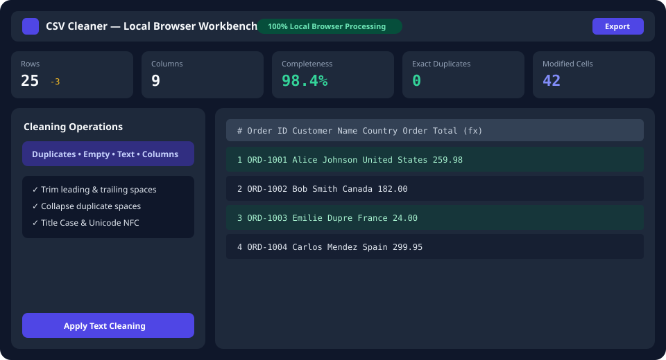

# CSV Cleaner

A fast, privacy-first, 100% browser-based workbench for cleaning, transforming, inspecting, and exporting **CSV** and **Excel (`.xlsx` / `.xls`)** spreadsheets — with zero backend servers, zero file uploads, and zero registration.

---

## Live Demo

**[https://majidramzi.github.io/csv-cleaner/](https://majidramzi.github.io/csv-cleaner/)**

> Open the live demo above and click **Load Sample** to try every cleaning, formula, diffing, and export feature immediately without uploading a file.

---

## Screenshots



*Interactive spreadsheet workbench featuring KPI health metrics, multi-tool cleaning sidebar, highlighted cell diffs, calculated formula columns, Undo/Redo history, and Light/Dark themes.*

---

## Features

- **100% Client-Side Execution**: Powered by HTML5 `FileReader`, `PapaParse`, and `SheetJS` directly inside browser memory. Spreadsheets never touch a network server.
- **Drag-and-Drop & Multi-Sheet Excel Import**: Inspect all worksheets inside `.xlsx` / `.xls` workbooks and switch sheets dynamically, or auto-detect / manually select CSV delimiters (`,`, `;`, `\t`, `|`).
- **Comprehensive Cleaning Pipeline**: Deduplicate records on custom column subsets, handle missing rows/columns/cells, standardize messy whitespace & Unicode text, manage columns, and compute formula columns.
- **Spreadsheet-Like Data Grid**: Built with `@tanstack/react-table` featuring column resizing, sticky headers, sticky row numbers, multi-type sorting, global search, text & numeric range filters, inline double-click cell editing, and responsive pagination for large files.
- **Cell Diff Inspection & Full Undo/Redo**: Toggle seamlessly between **Cleaned**, **Inline Diff (`old → new`)**, and **Original** dataset views, highlight changed cells, and step backward/forward (`Ctrl+Z` / `Ctrl+Y`) across up to 40 transformation snapshots.
- **Instant CSV & XLSX Export**: Preserves column order, renamed headers, calculated columns, and data types with a live export summary before downloading.
- **Built-In Dirty Sample Datasets**: Includes realistic messy e-commerce and semicolon-delimited HR datasets for instant evaluation.
- **Light & Dark Themes**: Accessible, responsive layout adapting cleanly from widescreen monitors to tablets and mobile screens.

---

## Supported File Formats

| Direction | Formats | Capabilities |
| :--- | :--- | :--- |
| **Import** | `.csv`, `.tsv`, `.txt` | UTF-8 & BOM support, quoted values, embedded commas/newlines, automatic & manual delimiter selection (`,`, `;`, `\t`, `\|`) |
| **Import** | `.xlsx`, `.xls` | Multi-worksheet discovery & switching, header preservation, empty cell handling, dates & mixed data types |
| **Export** | `.csv` | Custom delimiter selection (`,`, `;`, `\t`, `\|`), optional UTF-8 BOM for Microsoft Excel compatibility |
| **Export** | `.xlsx` | Native OpenXML Excel workbook with typed numeric/boolean/text cells, custom worksheet naming, and auto-sized column widths |

---

## Data Cleaning Operations

### 1. Duplicate Removal
- Identify duplicates across **all columns** or any **selected subset of key columns** (e.g., deduplicate by `Email` or `Order ID`).
- Toggle **case-sensitive** comparison and **ignore surrounding whitespace** during matching.
- Choose whether to keep the **first** or **last** occurrence.
- Preview the exact number of matching duplicate rows before applying and review removed row counts afterward.

### 2. Empty Data Handling
- **Automatic Detection**: Displays empty cell counts per column, completely empty columns, and dataset completeness percentage.
- **Remove Empty Rows**: Drop completely blank rows (*all* inspected columns empty) or incomplete rows (*any* inspected column empty).
- **Remove Empty Columns**: One-click removal of columns where 100% of values are empty.
- **Replace Empty Cells**: Impute empty values across one or all columns with a custom value (`N/A`, `0`, `Unknown`, etc.).

### 3. Text Cleaning & Normalization
- Trim leading and trailing spaces.
- Collapse duplicate internal spaces into a single space.
- Convert casing to `UPPERCASE`, `lowercase`, or `Title Case`.
- Normalize Unicode (`NFC`), replace non-breaking spaces (`\u00A0`), convert smart quotes/dashes to standard ASCII, strip invisible zero-width/control characters, and optionally remove accents/diacritics (`é → e`).

### 4. Column Management & Calculated Columns
- **Rename**, **Delete**, and **Reorder** columns with immediate table updates.
- **Calculated Columns**: Safe recursive-descent expression engine (zero `eval`) supporting:
  - Arithmetic: `[Unit Price] * [Quantity]`, `ROUND([Total] * 1.2, 2)`
  - String operations: `[First Name] & " " & UPPER([Last Name])`, `CONCAT()`, `TRIM()`, `LEN()`, `REPLACE()`
  - Logic & Fallbacks: `IF([Amount] >= 100, "Priority", "Standard")`, `COALESCE([Nickname], [First Name], "Guest")`
  - Live preview of calculated values on sample rows before adding the column.

### 5. Data Filtering & Sorting
- Instant global search across every row and column.
- Column-specific **text filters** (`contains`, `not_contains`, `equals`, `starts_with`, `ends_with`, `is_empty`, `is_not_empty`).
- Column-specific **numeric range filters** (`min` / `max`).
- Clickable column headers for ascending/descending sorting.
- Optional **Keep Only Filtered Rows** operation to permanently prune unmatched rows.

---

## Installation

### Prerequisites
- **Node.js** `>= 20.x`
- **npm** `>= 10.x`

### Steps

```bash
# Clone the repository
git clone https://github.com/majidramzi/csv-cleaner.git
cd csv-cleaner

# Install dependencies
npm install
```

---

## Development Commands

Start the local Vite development server with hot module replacement:

```bash
npm run dev
```

Open `http://localhost:5173/csv-cleaner/` in your browser.

---

## Testing Commands

Run the Vitest unit and integration test suite once (CI mode):

```bash
npm run test:run
```

Run Vitest in interactive watch mode during development:

```bash
npm test
```

Run strict TypeScript compiler checks without emitting files:

```bash
npm run typecheck
```

---

## Build Instructions

Create an optimized, type-checked production bundle in the `dist/` directory:

```bash
npm run build
```

Preview the compiled production build locally:

```bash
npm run preview
```

---

## Deployment Instructions

This repository is pre-configured for **GitHub Pages** at `/csv-cleaner/` (`vite.config.ts` sets `base: '/csv-cleaner/'`) and includes an automated GitHub Actions workflow at `.github/workflows/deploy.yml`.

1. Push the repository to GitHub under `https://github.com/majidramzi/csv-cleaner`.
2. In your GitHub repository, navigate to **Settings → Pages**.
3. Under **Build and deployment → Source**, select **GitHub Actions**.
4. Push to the `main` branch (or trigger the workflow manually from the **Actions** tab).
5. GitHub Actions will automatically install dependencies, run Vitest tests, verify strict TypeScript types, build `dist/`, and publish to:
   - **`https://majidramzi.github.io/csv-cleaner/`**

---

## Privacy Policy

**CSV Cleaner is 100% local by architecture:**
1. **No File Uploads**: Selected or dropped CSV/Excel files are parsed exclusively inside your web browser's JavaScript sandbox. No network requests transmit file data anywhere.
2. **No Persistent Dataset Storage**: Spreadsheets live only in volatile RAM while your browser tab remains open. Closing or reloading the page immediately clears all imported and transformed data. Only your UI theme preference (`light` or `dark`) is saved in `localStorage`.
3. **No Analytics or Registration**: Free and public with no accounts, cookies, or telemetry trackers.

---

## Technology Stack

- **UI Framework**: [React 19](https://react.dev/) + [TypeScript 5](https://www.typescriptlang.org/) (strict mode)
- **Build Tool**: [Vite 6](https://vite.dev/)
- **Styling**: [Tailwind CSS 3](https://tailwindcss.com/)
- **CSV Engine**: [PapaParse](https://www.papaparse.com/)
- **Excel Engine**: [SheetJS (`xlsx`)](https://sheetjs.com/)
- **Data Grid**: [TanStack Table v8](https://tanstack.com/table/latest)
- **Icons**: [Lucide React](https://lucide.dev/)
- **Testing**: [Vitest](https://vitest.dev/) + [React Testing Library](https://testing-library.com/)

---

## Project Structure

```text
csv-cleaner/
├── .github/
│   └── workflows/
│       └── deploy.yml              # CI/CD pipeline: test, typecheck, build & deploy to GitHub Pages
├── docs/
│   └── screenshot-workbench.svg    # README visual preview
├── public/
│   └── favicon.svg                 # Vector application icon
├── src/
│   ├── components/
│   │   ├── CleaningPanel.tsx       # Duplicates, Empty, Text, Columns, Filters & History sidebar
│   │   ├── DataTablePreview.tsx    # Resizable, paginated TanStack spreadsheet with diff & inline edit
│   │   ├── DatasetOverview.tsx     # KPI summary cards & expandable column data-type profiler
│   │   ├── ExportModal.tsx         # CSV/XLSX export dialog & summary metrics
│   │   ├── FileDropzone.tsx        # Drag-and-drop uploader & sample dataset launcher
│   │   ├── FileSourceBar.tsx       # Active file bar, CSV delimiter selector & Excel sheet switcher
│   │   ├── Header.tsx              # Top bar with Undo/Redo, Reset, Export, Privacy & Theme toggle
│   │   └── PrivacyModal.tsx        # Detailed client-side privacy notice dialog
│   ├── data/
│   │   └── sampleDatasets.ts       # Built-in messy sample CSV presets
│   ├── hooks/
│   │   ├── useDatasetHistory.ts    # Immutable Undo/Redo snapshot stack & keyboard shortcuts
│   │   └── useTheme.ts             # Light/Dark theme state management
│   ├── lib/
│   │   ├── cleaners/
│   │   │   ├── columnOperations.ts # Rename, delete, reorder, calculated columns & cell updates
│   │   │   ├── duplicates.ts       # Configurable duplicate detection & removal
│   │   │   ├── emptyData.ts        # Empty cell detection, row/column pruning & imputation
│   │   │   ├── filtering.ts        # Global search, text operators & numeric range filtering
│   │   │   ├── formulaEngine.ts    # Safe recursive-descent formula tokenizer, parser & evaluator
│   │   │   ├── metrics.ts          # Dataset health metrics & O(1) cell diff lookup
│   │   │   └── textCleaner.ts      # Whitespace, casing, Unicode NFC & accent normalization
│   │   ├── exporters/
│   │   │   └── exportData.ts       # CSV/XLSX export preparation, summary calculation & Blob download
│   │   └── parsers/
│   │       ├── csvParser.ts        # PapaParse wrapper with delimiter detection & BOM handling
│   │       ├── excelParser.ts      # SheetJS multi-worksheet parser
│   │       ├── fileImporter.ts     # Unified browser File importer
│   │       └── headerUtils.ts      # Header deduplication & safe scalar coercion
│   ├── test/
│   │   ├── app.integration.test.tsx
│   │   ├── columnOperations.test.ts
│   │   ├── duplicates.test.ts
│   │   ├── emptyData.test.ts
│   │   ├── exportData.test.ts
│   │   ├── parsers.test.ts
│   │   ├── setup.ts
│   │   └── textCleaner.test.ts
│   ├── types/
│   │   └── dataset.ts              # Strict shared TypeScript interfaces
│   ├── App.tsx                     # Root application state & layout orchestration
│   ├── index.css                   # Tailwind directives & custom scrollbars
│   └── main.tsx                    # React 19 DOM entry point
├── index.html
├── LICENSE
├── package.json
├── postcss.config.js
├── tailwind.config.js
├── tsconfig.app.json
├── tsconfig.json
├── tsconfig.node.json
└── vite.config.ts
```

---

## Limitations

- **Browser Memory Ceiling**: Because all parsing, Undo/Redo snapshots, and exports run locally in browser memory, optimal performance is achieved on files up to **~100,000 rows** (or ~50–100 MB CSV / ~25 MB XLSX depending on available device RAM).
- **Excel Formulas & Macros**: Imported `.xlsx` / `.xls` files read evaluated cell values rather than preserving Excel VBA macros, charts, or cell styling.
- **Password-Protected Workbooks**: Encrypted Excel files must be unlocked prior to import.

---

## Contributing

Contributions, bug reports, and feature enhancements are welcome!

1. Fork the repository and create a feature branch (`git checkout -b feat/your-feature`).
2. Make your changes adhering to strict TypeScript (`npm run typecheck`).
3. Add or update unit tests in `src/test/` and verify all tests pass (`npm run test:run`).
4. Ensure the production bundle builds cleanly (`npm run build`).
5. Open a Pull Request with a clear description of your improvements.

---

## License

Released under the [MIT License](./LICENSE).
